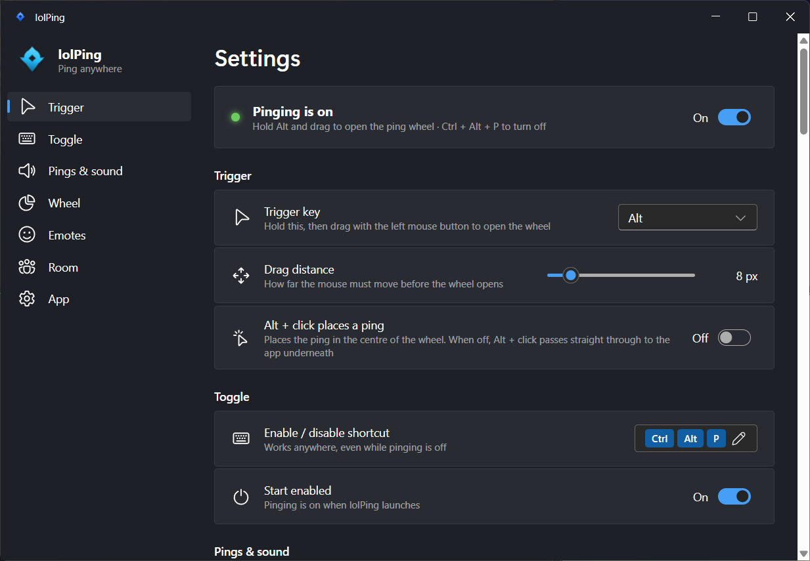

<h1 align="center"><br>lolPing</h1>

<p align="center">
  English | <a href="README.zh-CN.md">简体中文</a>
</p>

<p align="center">
  League of Legends pings and emotes for your whole desktop, on Windows and macOS.<br>
  Hold <b>Alt</b> (<b>⌥ Option</b> on a Mac), drag, and let go on a ping. The animation pops and the sound plays on top of any app, on any monitor.<br>
  Hold <b>Ctrl</b> (<b>⌃ Control</b> on a Mac) and drag for the emote wheel: League's emotes, or your own images.<br>
  Turn on the AI teammate and ping anything with <b>Win</b> (<b>⌘</b>) to have a model or a coding agent answer at that spot.
</p>

<p align="center">
  <a href="https://github.com/darrenprx/lolPing/releases/latest"><b>Download for Windows</b></a> ·
  <a href="https://github.com/darrenprx/lolPing/releases/latest"><b>Download for Mac</b></a> (Apple Silicon, experimental)
</p>

<p align="center">
  <a href="https://github.com/darrenprx/lolPing/actions/workflows/ci.yml"></a>
  <a href="https://github.com/darrenprx/lolPing/releases/latest"></a>
  <a href="LICENSE"></a>
</p>

<p align="center"></p>

Pings and emotes show up in whole-screen capture, so friends watching your Discord or OBS stream see them too. lolPing is a desktop toy: it doesn't read, change or hook into League itself.

## Linux (experimental)

This source tree includes an **X11 Linux port**, with AppImage and Debian package targets. It requires a genuine X11 session, XInput 2.1/XTest and a compositor. Wayland sessions, including XWayland inside Wayland, are not supported yet. Caps Lock triggers and automatic fullscreen-game detection are not available on Linux. Build with Node.js 22.12+, a C++20 compiler and `libx11-dev libxi-dev libxtst-dev`, then run `npm ci` and `npm run dist:linux`.

See [Linux build, installation and testing instructions](docs/linux.md) for package usage, desktop shortcut conflicts, tray requirements, HiDPI behavior and manual updates. Upstream releases may not yet contain this port.

## Install

### Windows

1. Download `lolPing-Setup-<version>.exe` from the [latest release](https://github.com/darrenprx/lolPing/releases/latest).
2. Run it. The installer isn't code-signed, so Windows SmartScreen may say "Windows protected your PC". Select **More info**, then **Run anyway**.
3. lolPing opens its settings and moves to the tray. Hold Alt and drag anywhere to ping.

lolPing is built for Windows 11, 64-bit. Windows 10 may work, but it isn't tested.

### macOS (experimental)

The Mac version needs an Apple Silicon Mac (M1 or later) and macOS 13 or later. It is built and tested automatically, but hasn't had much use on real Macs yet. Please [report](https://github.com/darrenprx/lolPing/issues) anything that doesn't work.

1. Download `lolPing-<version>-arm64.dmg` from the [latest release](https://github.com/darrenprx/lolPing/releases/latest), open it, and drag lolPing into Applications.
2. Open lolPing. It isn't signed by a registered Apple developer, so macOS says it can't check it for malware. Select **Done**, open **System Settings → Privacy & Security**, scroll down, select **Open Anyway** next to the lolPing message, and confirm.
   If macOS instead says lolPing "is damaged", run `xattr -dr com.apple.quarantine /Applications/lolPing.app` in Terminal and open it again.
3. lolPing asks for **Accessibility** access, which it needs to read the mouse and keyboard. Select **Open System Settings** and turn lolPing on. Pinging starts as soon as it's allowed.
4. lolPing lives in the menu bar. Hold ⌥ Option and drag anywhere to ping.

**After every update**, macOS forgets the Accessibility permission, because the app isn't signed with a fixed developer identity. In **Privacy & Security → Accessibility**, select lolPing, remove it with **–**, then turn it on again. The settings window walks you through it.

### Updating an older version

Updating from v0.4 or earlier: download the new version by hand once. From v0.5 on, lolPing updates itself (see [Updates](#updates)).

## Use

| To | Do this |
| --- | --- |
| Ping | Hold **Alt**, drag, and let go on a slice |
| Emote | Hold **Ctrl**, drag, and let go on an emote |
| Cancel | Let go in the centre, right-click, or press **Esc** |
| Pause or resume pinging | **Ctrl + Alt + P** |
| Type a line to the room (in a room) | **Alt + T**, type, then press **Enter** |
| Show who is in the room (in a room) | Hold **Tab** |
| Ask the AI teammate (when it's on) | Hold **Win**, drag, and let go on a ping over what you're asking about |
| Ask the teammate in your own words | **Win + click** |
| Open settings | Click the tray icon |
| Quit, or restart the input helper | Right-click the tray icon |

On a Mac, use **⌥ Option** instead of Alt, **⌃ Control** instead of Ctrl for emotes, **⌘** instead of Win to ask (double-tap **⌘** to ask in words), **⌃⌥P** to pause, and the ping icon in the menu bar instead of the tray icon.

The wheel, from the top going clockwise: Danger, Push, On My Way, All In, Assist Me, Need Vision, Enemy Missing, Enemy Vision. You can rearrange it and add Bait, Vision Cleared or an upside-down Enemy Missing ("¿") in settings. The emote wheel has 8 slots too, and you pick its emotes in settings. Each imported image plays its own signature effect (a spin, a bounce, a heartbeat...), picked by right-clicking it in the settings window from a grid where every effect plays live on that image.

## Settings



- **Trigger key:** Alt, Ctrl, Shift, Win, Caps Lock, Mouse 4, Mouse 5 or any other key (on a Mac: Option, Control, Shift, Command, Mouse 4, Mouse 5 or any other key). A custom key still types when tapped, but its letter appears when the key comes up, and holding it alone doesn't repeat.
- **Alt + click places a ping:** off by default, so ordinary Alt + click shortcuts keep working. The ping is the one in the centre of the wheel editor (Generic unless you change it).
- **Pause in fullscreen apps:** on by default. A fullscreen game keeps every click — trigger + click does nothing there — and gestures resume on the desktop and on other monitors. Windowed games aren't detected, and with an auto-hiding taskbar only borderless fullscreen counts. Windows only for now.
- **App exceptions:** name apps (by process name, or captured from whatever is in front) where lolPing stands down entirely — gestures and hotkeys pass through, so Photoshop's Option + click colour picker and a Tab that toggles panels keep working.
- **Enable / disable shortcut:** must include Ctrl, Alt or Win (⌃, ⌥ or ⌘ on a Mac).
- **Pings and sound:** size, duration, volume, mute and the wheel's tick sound. **Keep my last ping on screen** leaves your newest ping up until your next one or until you pause lolPing, for example to mark where you stopped reading.
- **Wheel:** adjust the size of both the ping and emote wheels, without changing placed pings or emotes. Drag any ping onto any slice, including Bait, Vision Cleared and the upside-down Enemy Missing, or onto the centre to make it the Alt + click ping. Click a ping to preview it. **Reset to default** brings back League's layout.
- **Emotes:** the emote key (Ctrl by default, or off), **Ctrl + click places an emote** (off by default), emote size, emote sound and the emote wheel, which you edit like the ping wheel. **Add image…**, or dropping a file on the list, adds your own images: PNG, JPG, GIF or WebP, up to 24. Animated ones play on your screen only. The speaker on one of your images gives it a sound (MP3, OGG or WAV, up to 1 MB and 5 seconds), which plays on your computer only.
- **Room:** your name and tag colour, how friends' text appears (at the spot they pointed at, or scrolling across the top as 弹幕), the **text shortcut** (Alt + T by default) and the **room panel key** (Tab by default). The text shortcut and the panel key reach other apps except while you are in a room.
- **Features:** turns on the AI teammate (off by default, see [AI teammate](#ai-teammate)), and turns off the parts you don't use: emotes, and rooms with room text, votes and the room panel under it. A feature that is off has no keys, no settings section, sends nothing and ignores what friends send for it.
- **Launch at Windows startup** (**Open at login** on a Mac): starts hidden in the tray or menu bar.
- **Language:** follows the system display language, or pick English or 简体中文.

Settings are saved in `%APPDATA%\lolPing\settings.json` on Windows and `~/Library/Application Support/lolPing/settings.json` on a Mac.

## Updates

lolPing checks GitHub for a new version 10 seconds after it starts, then every 6 hours. When there is one, you get a notice on screen, and the tray menu and **Settings → App → About** offer **Update**. It asks first: nothing downloads until you click.

- **Windows:** one click downloads the installer, verifies it, installs it silently into the same folder and restarts lolPing. The settings window opens after the restart.
- **Mac:** lolPing downloads the disk image to your Downloads folder, verifies it, explains what to do, opens it, and quits. Drag lolPing into Applications, choose **Replace**, open it, and allow Accessibility again.
- **Check for updates** in the tray menu, or in **Settings → App → About**, checks right away. From the tray, the result (up to date, or what went wrong) appears as a notice on screen.
- **Check for updates automatically** (Settings → App, on by default) controls the scheduled checks. With it off, lolPing contacts GitHub only when you click **Check for updates** or **Update**.
- **Privacy:** a check tells GitHub your IP address and lolPing's version, nothing else.

## Ping with friends (rooms)

Join a room and everyone in it sees your pings on their own screen, at the same spot (scaled to their resolution), with your name under them. Their pings show up on yours. It works between Windows and Mac.

1. One person opens **Settings → Room** (or the tray menu → **Room**) and clicks **Create room**.
2. They copy the code, such as `PING-7KQ4M-2HXTR`, and send it to friends.
3. Each friend copies it and clicks **Join from clipboard** in the tray menu, or pastes it into the Room page and clicks **Join**.

- **Same network:** the first time, Windows asks whether lolPing may use the network: allow it, and set your Wi‑Fi to **Private** (Windows blocks it on Public networks). A Mac asks to find devices on the local network.
- **Different networks:** with **Allow internet connections** on (the default), friends anywhere join with the same code. Their pings travel through free public [Nostr](https://nostr.com) relays and take a moment longer than on a local network, which is still used whenever it works. Virtual LANs such as ZeroTier or Radmin VPN work too, and Tailscale users simply connect over the internet.
- A ping lands on the display with the same number (1 is the primary display), or on display 1.
- **Emotes** travel like pings: friends see yours on their own screen with your name under it. Your own images reach friends as a small still picture; animations and sounds stay on your computer. Friends' images are kept in a small cache on your computer. **Show friends' custom emotes** in Settings → Room turns this off both ways: nothing is sent or fetched, and friends' images show as "?". Friends on v0.4 or older don't see emotes, and the Room page says so under their names. Friends on older versions may not see newer message types.
- **Text:** press **Alt + T** (**⌥T** on a Mac), type up to 120 characters and press **Enter**. Esc cancels. Friends see the line with your name, either at the spot where your pointer was or scrolling across the top of their screen, as they chose in Settings → Room. You see it too. `/ff`, `/noff` and `/ready` work as in League's chat and are not sent as text.
- **Votes:** `/ff` or the **Surrender** button on the panel starts a surrender vote. It passes when 70% of the people in the room say yes (4 of 5), and ends early once the result is clear. **Ready check** needs everyone to accept. **Kick** (the button on a person's row) removes someone when more than half of the others say yes. Votes last 60 seconds, a ready check 15. A missing answer counts as no. Answer a surrender or kick vote with the ✓ and ✗ at the right edge of your screen, and a ready check with Accept or Decline in the centre, which plays League's ready check sounds at your ping volume; they take clicks without taking focus from your game or app.
- **Kick is best effort:** every app counts the votes itself, so a lost packet can leave someone in a room that others have left. A kicked person can join again by typing the room code again; to keep someone out, leave and create a new room.
- **Room panel:** hold **Tab** to see everyone in the room, with their tag colour, whether they are on, paused, muted or can't see text and votes, and whether they are on your network or the internet. Click a name to post "<name> - Alive", as on League's scoreboard. The speaker button mutes one person. The **History** tab lists this session's text and vote results, up to 200 lines, and is cleared when you leave.
- **Tab and other apps:** while you are in a room, a held Tab doesn't reach other apps, because the panel takes it. Alt + Tab, Ctrl + Tab and Shift + Tab are not touched, and a fullscreen game keeps its own Tab while **Pause in fullscreen apps** is on (Windows). Outside a room, or with lolPing paused, Tab works as usual. You can pick another panel key or turn the panel off in Settings → Room and Settings → Features.
- **Mute room**, muting one person, and an **Incoming ping, emote and text limit** (up to Unlimited, counted together) keep the spam under control. Pausing lolPing with the shortcut pauses all room content too.
- A room holds up to 16 people. To remove someone, start a kick vote, or leave and create a new room.
- **Privacy:** pings, emotes, text, votes, your emote images and names are end-to-end encrypted with a key made from the room code, and text and votes use no new network hosts. People on your network can see your local IP address. With internet connections on, public relays see your IP address, an anonymous room ID and when you send, but never your content, images or name. Turn **Allow internet connections** off to stay on your local network.

## AI teammate

Ping something on your screen with the ask wheel and an AI teammate answers at that spot: a short line, its own pings on what it means, and a card with the full answer. It can also do the thing you pinged, after asking you. It uses a model you have a key for, a local model, or a coding agent on your computer. It is off until you turn it on in **Settings → Features**, and works on Windows and macOS (not on Linux yet).

1. Turn on **AI teammate** in Settings → Features. A short card sets the ask key and who answers.
2. **Add profile** in Settings → Teammate: pick a provider, paste your key, **Check key** (it lists the models, without using any tokens) and choose a model. The model has to read images. Or pick a coding agent such as Claude Code.
3. Hold **Win** (⌘ on a Mac), drag, and let go on a ping over what you're asking about.

Each ping asks for something. You can rename each one, change what it asks for, or switch it off in Settings → Teammate → Intents.

| Ping | Asks |
| --- | --- |
| Enemy Missing (?) | **Explain** what this is or means |
| Push | **Keep going**: continue the thread at the new spot |
| Danger | **What's wrong**: errors, typos, wrong numbers, risky terms, scams |
| Assist Me | **Show me how**, step by step, without changing anything |
| On My Way | **Do it**: write the reply, fill the form, or with an agent edit the code |
| Need Vision | **Look it up**: background, definitions, sources |
| All In | **Whole picture**: a summary of the whole page or file |
| Enemy Vision | **Grab** text, a table or a date into the clipboard or your calendar |
| Vision Cleared | **Polish** the text there, ready to replace it |
| Upside-down Missing (¿) | **Translate** it |
| Bait | **Save for later** in history |

- **In your own words:** Win + click opens a box at the spot for a typed question. Double-tapping the ask key opens the same box at the pointer. On a Mac, double-tapping ⌘ is on and ⌘ + click is off by default; on Windows it's the other way round. Both are in Settings → Teammate → Ask key.
- **Several spots:** keep the ask key held and ping up to 4 spots on one screen, for example three prices to compare. They go as one ask when you let go.
- **Answers:** a line by the spot, the teammate's pings on what it means, and **More** for the card. Reply in the card, or ping Push at a new spot, to continue. When you scroll, move the window or switch apps, the teammate's pings fade, since what they pointed at has moved.
- **Same key:** the ask key can be the ping key (**Same as the ping key**). Your pings then go to the teammate only, not to friends in a room.
- **Doing things:** copy happens at once. Paste, replace, a calendar event and opening a link ask first on a card: **Allow once**, **Always allow** or **Decline**. A form fill always shows a preview of every field first, never fills passwords, card numbers or ID numbers, and never submits. Paste waits until your hands are off the mouse and keyboard, and puts your clipboard back after. **Always allowed** in Settings lists what you allowed for good, each with Remove.
- **Profiles:** Anthropic, OpenAI, Google Gemini, DeepSeek, Qwen, Kimi, GLM, Doubao, MiniMax, Mistral, xAI, OpenRouter, Ollama, LM Studio, or any OpenAI-compatible address. **App rules** send asks from one app to one profile, and a **Whole picture profile** can take the long answers.
- **Coding agents:** Claude Code and DeepSeek Harness are tested. Codex, Gemini CLI, Qwen Code, Copilot CLI, Cursor CLI, opencode, Kimi Code, Auggie, Goose, Droid, Qoder CLI and Kiro CLI are included but not tested yet. An agent runs in its project folder, a fixed one or the one open in your editor. lolPing asks you before Claude Code edits a file or runs a command; other agents follow their own approval settings. **Suggest rules for my editors** sends Do it and What's wrong from VS Code, Cursor and JetBrains IDEs to the agent. **Open in <agent>** in History continues an agent's session in a terminal.
- **Agents ping you:** with **Let agents ping me** on, a coding agent you run yourself (in a terminal or an editor) can draw a ping or say a line near your pointer while it works. **Connect an app** copies the snippet for Claude Code, Claude Desktop, Codex, Cursor, VS Code, Windsurf, Zed, JetBrains IDEs and others; lolPing never edits their files.
- **Your instructions:** a text box in Settings → Teammate sent with every ask, for example your tone, language, and the name and details to use in forms and replies.
- **History:** asks and answers are kept on your computer, encrypted, for 30 days (up to 500 threads). Pause, clear or open it in Settings → Teammate. **Usage this month** shows the tokens your providers reported.
- **Privacy:** nothing is captured until you ask. An ask sends a picture of the display under the spot, a closer view around it, the app and window title, what the teammate reads, the thread so far and Your instructions to the provider of the profile, and to no one else. **What the teammate reads** sets which of these it may read: text and buttons on screen, selected text and the focused field, the file behind the window (for Whole picture), and PDFs you view in the browser (off by default; the PDF is then downloaded once from its address, without your cookies). A coding agent gets the same through a local connection that has no network port, and sends it to its own provider. Keys, Your instructions and history stay on your computer, encrypted by the system. lolPing contacts no hosts of its own for this: only the providers you set up, and whatever an agent reaches.
- On a Mac the teammate needs **Screen Recording** as well as Accessibility. The settings window walks you through it.

## Known limitations

- The wheel can't open over windows running as administrator, such as Task Manager. Windows hides their input from normal apps.
- Exclusive-fullscreen games draw above the overlay.
- Sharing a single window doesn't include the pings. Share your entire screen instead.
- While you are in a room, a held Tab shows the room panel and doesn't reach other apps, and Alt + T opens the text box instead of reaching the app underneath. Change these keys, or turn the features off, in Settings → Room and Settings → Features.
- While lolPing is on, Ctrl + drag opens the emote wheel instead of copying files or text. Pick another emote key, or turn it off, in Settings → Emotes.
- The AI teammate isn't available on Linux yet. It can't paste into windows running as administrator, and it can't fill form fields that an app hides from accessibility tools.
- On a Mac, the wheel can't open while a secure screen is showing, such as the login window or a password prompt, and Accessibility has to be allowed again after each update.

## Build from source

You need Node 22.12 or later, plus:

- **Windows:** Windows 11 and Visual Studio 2022 or later with the "Desktop development with C++" workload.
- **macOS:** an Apple Silicon Mac with the Xcode Command Line Tools (`xcode-select --install`). Allow Accessibility for the app that runs `npm run dev` (for example Terminal) so the helper can read input.

```bash
npm install
npx install-electron
npm run build:helper
npm run dev
```

`npx install-electron` downloads the Electron binary that `npm run dev` needs.

| Command | What it does |
| --- | --- |
| `npm test` | TypeScript tests, including a protocol test that runs the real helper in `--simulate` mode |
| `npm run test:helper` | Builds the helper and runs its C++ tests |
| `npm run typecheck` | Type-checks everything |
| `npm run dist` | Builds the Windows installer into `release/` |
| `npm run dist:mac` | Builds the Mac disk image into `release/` (on a Mac) |
| `npm run dev:site` | Serves a browser demo of the wheel (`site/`) |
| `npm run media` | Re-records `docs/media/demo.gif` and `docs/media/og.png` from that demo (needs ffmpeg) |
| `node tools/room-peer/run.mjs <code>` | Joins a room as a fake member that pings at random, to try rooms with one computer; `--relay` joins through the relays and `--emotes` also sends emotes (see [`tools/room-peer`](tools/room-peer)) |
| `node tools/relay-probe/run.mjs` | Tests which public Nostr relays can carry rooms; it chose the list in `src/main/relays.ts` (see [`tools/relay-probe`](tools/relay-probe)) |

### Releasing

Bump `version` in `package.json`, commit, then push a matching tag such as `v0.2.0`. The Release workflow creates the GitHub release as a draft. The Windows job attaches the installer, `latest.yml` and the installer's `.blockmap`, and the Mac job attaches the disk image. electron-updater needs both `latest.yml` and the `.blockmap` to update installed copies. A last job publishes the release once everything is attached.

## How it works

- **Input:** [`native/hook-helper`](native/hook-helper) is a small C++ process that owns the low-level mouse and keyboard hooks on Windows, or an event tap on macOS. It swallows the Alt + drag so the app underneath never sees it, and talks to Electron in JSON lines over stdin and stdout.
- **Display:** Electron draws the wheel and pings in one transparent, click-through, always-on-top window per monitor ([`src/renderer/overlay`](src/renderer/overlay)), and plays the sounds through Web Audio.
- **Rooms:** [`src/main/roomManager.ts`](src/main/roomManager.ts) keeps the room's members and encrypts every message (AES-256-GCM, key from scrypt over the room code). [`src/main/lanTransport.ts`](src/main/lanTransport.ts) carries the encrypted packets over UDP on the local network, and [`src/main/relayTransport.ts`](src/main/relayTransport.ts) through public Nostr relays as ephemeral events.
- **Updates:** [`src/main/updater.ts`](src/main/updater.ts) runs the schedule and the state the tray and settings show. [`src/main/updateWin.ts`](src/main/updateWin.ts) updates through electron-updater and the `latest.yml` on the release, and [`src/main/updateMac.ts`](src/main/updateMac.ts) reads the GitHub releases API and checks the disk image against its SHA-256.
- **AI teammate:** [`src/main/teammate`](src/main/teammate) runs the asks. A second native process, the context helper (`native/hook-helper/src/context_*`), captures the screen, reads text and form fields through UI Automation or the Accessibility API, and pastes, so none of that runs next to the input hooks. Models are called with plain `fetch` (OpenAI-compatible and Anthropic APIs); coding agents reach lolPing through a stdio MCP server ([`src/main/mcp`](src/main/mcp)) over a local pipe or socket.
- **Settings:** a Fluent UI window ([`src/renderer/settings`](src/renderer/settings)) with Mica on Windows, restyled like System Settings on macOS.
- **Demo page:** [`site`](site) runs the same overlay code in the browser, with a small input shim in place of the helper. The README GIF is recorded from it.
- **Design notes:** [docs/design.md](docs/design.md) covers the protocol, the input state machine and the multi-monitor maths. [docs/design-macos.md](docs/design-macos.md) covers the Mac port.

## Contributing

Pull requests and ideas are welcome. Before you start:

- Read [AGENTS.md](AGENTS.md): the layout, the behaviour every change keeps, and the code, test and commit conventions. If you use an AI tool, give it that file too. Claude Code reads it through `CLAUDE.md`, and most other agents read `AGENTS.md` on their own.
- Title the pull request in [Conventional Commits](https://www.conventionalcommits.org/) style, such as `fix(helper): keep clicks in order after a cancelled wheel`. Pull requests are squash-merged, so the title becomes the commit on `main`.
- Keep one change per pull request and fill in the template. CI has to pass on Windows and macOS before anything merges.
- For bigger ideas, open an issue or a [discussion](https://github.com/darrenprx/lolPing/discussions) first, so we can agree on the approach before you write it.

## Ping assets

The icons in `assets/textures` and the sounds in `assets/sounds` come from a local League of Legends install. [`tools/extract-assets`](tools/extract-assets) explains how to extract them again after a patch. The emote animations, icons and sounds in `assets/emotes` are © Riot Games too, and `tools/extract-assets --emotes` bakes them from the same install.

## License

The code is under the [MIT license](LICENSE). The ping and emote icons, animations and sounds are © Riot Games and aren't covered by it. If you represent Riot Games and want something removed, please open an issue.

lolPing isn't endorsed by Riot Games and doesn't reflect the views or opinions of Riot Games or anyone officially involved in producing or managing Riot Games properties. Riot Games, and all associated properties are trademarks or registered trademarks of Riot Games, Inc.
