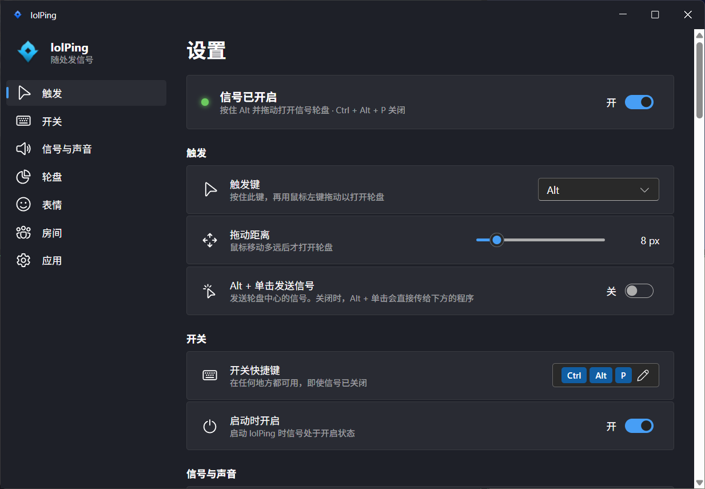

<h1 align="center"><br>lolPing</h1>

<p align="center">
  <a href="README.md">English</a> | 简体中文
</p>

<p align="center">
  把英雄联盟的信号和表情搬到整个桌面，支持 Windows、macOS，以及实验性的 Linux X11 版本。<br>
  按住 <b>Alt</b>（Mac 上是 <b>⌥ Option</b>）拖动，在想要的信号上松开：动画弹出、音效响起，任何程序之上、任何显示器上都可以。<br>
  按住 <b>Ctrl</b>（Mac 上是 <b>⌃ Control</b>）拖动打开表情轮盘：英雄联盟的表情，或你自己的图片。<br>
  打开 AI 队友后，按住 <b>Win</b>（<b>⌘</b>）对任何东西发信号，模型或编程代理会在那个位置回答。
</p>

<p align="center">
  <a href="https://github.com/darrenprx/lolPing/releases/latest"><b>下载 Windows 版</b></a> ·
  <a href="https://github.com/darrenprx/lolPing/releases/latest"><b>下载 Mac 版</b></a>（Apple 芯片，实验性）
</p>

<p align="center">
  <a href="https://github.com/darrenprx/lolPing/actions/workflows/ci.yml"></a>
  <a href="https://github.com/darrenprx/lolPing/releases/latest"></a>
  <a href="LICENSE"></a>
</p>

<p align="center"></p>

信号和表情会出现在全屏录制/共享画面里，所以在 Discord 或 OBS 上看你直播的朋友也能看到。lolPing 只是一个桌面小玩具：它不会读取、修改或注入英雄联盟本身。

## 安装

### Windows

1. 从[最新版本](https://github.com/darrenprx/lolPing/releases/latest)下载 `lolPing-Setup-<版本号>.exe`。
2. 运行安装程序。安装程序没有代码签名，Windows SmartScreen 可能会提示“Windows 已保护你的电脑”：点击**更多信息**，再点**仍要运行**。
3. lolPing 会打开设置窗口并常驻系统托盘。按住 Alt 在任意位置拖动即可发信号。

lolPing 面向 64 位 Windows 11。Windows 10 也许可以用，但没有测试过。

### macOS（实验性）

Mac 版需要 Apple 芯片（M1 或更新）的 Mac 和 macOS 13 或更新版本。它会自动构建和测试，但还没在真实的 Mac 上用过多少。遇到问题请[反馈](https://github.com/darrenprx/lolPing/issues)。

1. 从[最新版本](https://github.com/darrenprx/lolPing/releases/latest)下载 `lolPing-<版本号>-arm64.dmg`，打开后把 lolPing 拖进“应用程序”。
2. 打开 lolPing。它没有经过注册 Apple 开发者的签名，macOS 会提示无法检查其是否包含恶意软件：点“完成”，打开**系统设置 → 隐私与安全性**，向下滚动，在 lolPing 的提示旁点**仍要打开**并确认。
   如果 macOS 提示 lolPing“已损坏”，请在“终端”中运行 `xattr -dr com.apple.quarantine /Applications/lolPing.app`，然后再次打开。
3. lolPing 会请求**辅助功能**权限，用来读取鼠标和键盘。点“打开系统设置”并打开 lolPing。授权后立即可以发信号。
4. lolPing 常驻菜单栏。按住 ⌥ Option 在任意位置拖动即可发信号。

**每次更新后**，macOS 都会忘记辅助功能权限，因为应用没有固定的开发者签名。在**隐私与安全性 → 辅助功能**中选中 lolPing，点 **–** 移除，再重新打开。设置窗口会一步步提示你。

### Linux（实验性，X11）

此源码分支已增加 Linux 支持，在 Ubuntu 24.04 / X11 上开发验证。请使用真正的 **X11 / Xorg 登录会话**；目前不支持 Wayland（包括 Wayland 会话中的 XWayland）。

- 构建：安装 Node.js 22.12+、C++20 编译器及 `libx11-dev libxi-dev libxtst-dev`，运行 `npm ci` 和 `npm run dist:linux`。
- 输出：`release/` 中的 `.AppImage` 和 `.deb`。Ubuntu/Debian 推荐 `sudo apt install ./release/lolPing-0.5.1-amd64.deb`。
- 操作与 Windows 类似；如 Alt + 拖动被桌面占用，请在设置中更换触发键。Linux 不提供 Caps Lock 触发键或全屏游戏自动检测。
- 需要桌面合成器；GNOME 需要 AppIndicator 扩展显示托盘。Linux 目前手动更新，界面使用 1:1 屏幕像素，不跟随 HiDPI 缩放。
- 设置在 `~/.config/lolPing/settings.json`，登录启动项在 `~/.config/autostart/lolPing.desktop`（支持 `XDG_CONFIG_HOME`）。

完整开发、测试步骤和平台限制见 [Linux 说明](docs/linux.md)。上游发布页不一定已有本分支的 Linux 包。

### 升级旧版本

从 v0.4 或更早的版本更新：请手动下载一次新版本。从 v0.5 起，lolPing 会自己更新（见[更新](#更新)）。

## 使用

| 想要 | 操作 |
| --- | --- |
| 发信号 | 按住 **Alt** 拖动，在某个扇区上松开 |
| 发表情 | 按住 **Ctrl** 拖动，在某个表情上松开 |
| 取消 | 在中心松开、点右键，或按 **Esc** |
| 暂停 / 恢复 | **Ctrl + Alt + P** |
| 向房间发一句话（在房间中） | **Alt + T**，输入后按 **Enter** |
| 查看房间里有谁（在房间中） | 按住 **Tab** |
| 问 AI 队友（打开后） | 按住 **Win** 拖动，在要问的东西上方的信号处松开 |
| 用文字问队友 | **Win + 点击** |
| 打开设置 | 单击托盘图标 |
| 退出，或重启输入助手 | 右键托盘图标 |

在 Mac 上：用 **⌥ Option** 代替 Alt，用 **⌃ Control** 代替 Ctrl 发表情，用 **⌘** 代替 Win 提问（连按两下 **⌘** 用文字提问），用 **⌃⌥P** 暂停，用菜单栏中的信号图标代替托盘图标。

轮盘从正上方开始顺时针依次是：危险（撤退）、推进、正在赶来、全力进攻（All In）、请求协助、需要视野、敌人消失、敌方视野。可以在设置中重新排列，或换上诱饵、视野已清除、反向问号（倒过来的敌人消失）。表情轮盘同样有 8 个扇区，要放哪些表情在设置中选择。每张导入的图片都有自己的专属特效（螺旋登场、落地弹跳、心跳律动……），在设置窗口中右键图片，即可在一个个实时演示的特效宫格里挑选。

## 设置



- **触发键：** Alt、Ctrl、Shift、Win、Caps Lock、鼠标侧键 4/5，或任意其他按键（Mac 上：Option、Control、Shift、Command、鼠标侧键 4/5，或任意其他按键）。自定义按键单按时仍会输入字符，但字符在松开按键时才出现，单独按住也不会连续输入。
- **Alt + 单击发送信号：** 默认关闭，这样平时的 Alt + 单击快捷操作不受影响。发送的是轮盘编辑器中心的信号（默认是普通信号）。
- **全屏程序中暂停：** 默认开启。全屏游戏独占所有点击——触发键 + 单击原样交给程序——回到桌面或在其他显示器上手势恢复正常。窗口化游戏检测不到；任务栏自动隐藏时只识别无边框全屏。目前仅限 Windows。
- **开关快捷键：** 必须包含 Ctrl、Alt 或 Win（Mac 上为 ⌃、⌥ 或 ⌘）。
- **信号与声音：** 大小、持续时间、音量、静音、轮盘提示音。打开**保留我最后一个信号**后，你最新的信号会一直留在屏幕上，直到你发出下一个信号或暂停 lolPing，比如用来标记读到哪里。
- **轮盘：** 可以调整信号和表情轮盘的大小，不影响已放出的信号或表情。把任意信号（包括诱饵、视野已清除和反向问号）拖到任意扇区，或拖到中心设为 Alt + 单击发送的信号。单击信号可预览。**恢复默认**会还原英雄联盟的布局。
- **表情：** 表情键（默认 Ctrl，也可以关闭）、**Ctrl + 单击发送表情**（默认关闭）、表情大小、表情音效，以及表情轮盘（编辑方式和信号轮盘相同）。点**添加图片…**，或把文件拖到列表上，可以加入自己的图片：PNG、JPG、GIF 或 WebP，最多 24 张。动图只在你自己的屏幕上播放。点自己图片上的喇叭可以给它加声音（MP3、OGG 或 WAV，最大 1 MB，最长 5 秒），只在你自己的电脑上播放。
- **房间：** 你的名字和标签颜色、好友的文字怎么显示（显示在对方指的位置，或作为弹幕从屏幕上方划过）、**文本快捷键**（默认 Alt + T）和**房间面板按键**（默认 Tab）。只有在房间里时，文本快捷键和面板按键才不会传给其他应用。
- **功能：** 打开 AI 队友（默认关闭，见 [AI 队友](#ai-队友)），也可以关掉你用不到的部分：表情，以及房间和它下面的房间文字、投票和房间面板。关闭的功能没有按键、没有设置项、不发送任何内容，也会忽略好友发来的相关内容。
- **开机启动**（Mac 上为**登录时打开**）：启动后隐藏在托盘或菜单栏中。
- **语言：** 默认跟随系统显示语言，也可以手动选择 English 或简体中文。

设置在 Windows 上保存在 `%APPDATA%\lolPing\settings.json`，在 Mac 上保存在 `~/Library/Application Support/lolPing/settings.json`。

## 更新

Windows 和 macOS 版本在启动 10 秒后向 GitHub 检查一次新版本，之后每 6 小时检查一次。有新版本时，屏幕上会出现提示，托盘菜单和**设置 → 应用 → 关于**里也会出现**更新**。更新前会先询问：在你点击之前不会下载任何内容。

- **Windows：** 点一下即可下载安装程序、校验、静默安装到原来的文件夹，并重启 lolPing。重启后会打开设置窗口。
- **Mac：** lolPing 把磁盘映像下载到“下载”文件夹，校验后先说明接下来的步骤，再打开它，然后退出。请把 lolPing 拖进“应用程序”，选择**替换**，打开它，并再次允许辅助功能。
- 托盘菜单或**设置 → 应用 → 关于**中的**检查更新**会立即检查。从托盘菜单检查时，结果（已是最新版本，或出错的原因）会以屏幕通知的形式显示。
- **自动检查更新**（设置 → 应用，默认开启）控制定时检查。关闭后，只有在你点击**检查更新**或**更新**时，lolPing 才会联系 GitHub。
- **隐私：** 每次检查都会让 GitHub 知道你的 IP 地址和 lolPing 的版本号，别的都不会发送。

## 和朋友一起发信号（房间）

加入房间后，房间里的每个人都会在自己的屏幕上看到你的信号：位置相同（按各自的分辨率换算），下面带着你的名字。他们的信号也会出现在你的屏幕上。Windows 和 Mac 之间可以互通。

1. 一个人打开**设置 → 房间**（或托盘菜单 → **房间**），点击**创建房间**。
2. 复制房间码（例如 `PING-7KQ4M-2HXTR`）发给朋友。
3. 朋友复制房间码后，在托盘菜单中点击**从剪贴板加入**，或粘贴到房间页面后点击**加入**。

- **同一网络：** 第一次使用时，Windows 会询问是否允许 lolPing 使用网络：请允许，并把 Wi‑Fi 设置为**专用网络**（公用网络会被 Windows 阻止）。Mac 会询问是否允许查找本地网络中的设备。
- **不同网络：** 打开**允许互联网连接**（默认开启）后，任何地方的朋友都能用同一个房间码加入。信号通过免费的公共 [Nostr](https://nostr.com) 中继传输，比局域网稍慢一点；能走局域网时仍会优先使用局域网。ZeroTier、Radmin VPN 等虚拟局域网同样可用，Tailscale 用户则会直接通过互联网连接。
- 信号会显示在编号相同的显示器上（1 号是主显示器），没有则显示在 1 号上。
- **表情**和信号一样发给房间：朋友会在自己的屏幕上看到，下面带着你的名字。你自己的图片会以一张小的静态图发给朋友，动图和声音只留在你的电脑上。朋友的图片保存在你电脑上的一个小缓存里。关闭设置 → 房间里的**显示好友的自定义表情**后，两边都停止：不发送也不获取，朋友的图片显示为“?”。还在用 v0.4 或更早版本的朋友看不到表情，房间页面会在他们的名字下面提示。旧版本可能看不到较新的消息类型。
- **文字：** 按 **Alt + T**（Mac 上是 **⌥T**），输入最多 120 个字，按 **Enter** 发送，Esc 取消。朋友会看到这句话和你的名字，显示在你指的位置，或作为弹幕从他们屏幕上方划过，由他们在设置 → 房间里选择。你自己也能看到。`/ff`、`/noff` 和 `/ready` 的用法和英雄联盟的聊天一样，不会作为文字发出。
- **投票：** `/ff` 或面板上的**投降**按钮会发起投降投票，房间里 70% 的人同意（5 人中的 4 人）就通过，结果明确后会提前结束。**就位确认**需要所有人接受。**踢出**（某个人那一行的按钮）在其他人中超过一半同意时把他移出房间。投票持续 60 秒，就位确认 15 秒，没有回应算反对。投降和踢出用屏幕右侧的 ✓ 和 ✗ 作答，就位确认用屏幕中央的接受和拒绝作答，并按信号音量播放英雄联盟的就位确认音效；它们能接收点击，但不会抢走游戏或其他程序的焦点。
- **踢出尽力而为：** 每个应用各自统计票数，所以丢包可能让别人已经离开的房间里还留着某个人。被踢出的人再输入一次房间码就能重新加入；想把某人挡在外面，请离开并创建一个新房间。
- **房间面板：** 按住 **Tab** 查看房间里的所有人：标签颜色、是否在线、已暂停、已静音或看不到文字和投票，以及走的是局域网还是互联网。点名字会发出“<名字> - 存活”，和英雄联盟的计分板一样。喇叭按钮可以静音某个人。**记录**页列出本次的文字和投票结果，最多 200 行，离开房间时清空。
- **Tab 和其他应用：** 在房间里时，按住的 Tab 不会传给其他应用，因为面板会接收它。Alt + Tab、Ctrl + Tab 和 Shift + Tab 不受影响；开着**全屏程序中暂停**时（Windows），全屏游戏也保留自己的 Tab。不在房间里或 lolPing 已暂停时，Tab 照常使用。你可以在设置 → 房间里换一个面板按键，也可以在设置 → 功能里关掉面板。
- **房间静音**、单独静音某个人，以及**接收信号、表情和文本上限**（可选不限，合并计算）可以控制刷屏。用快捷键暂停 lolPing 时，房间里的所有内容也会一起暂停。
- 一个房间最多 16 人。想移出某人，可以发起踢出投票，或者离开并创建一个新房间。
- **隐私：** 信号、表情、文字、投票、表情图片和名字使用由房间码生成的密钥进行端到端加密，文字和投票不使用任何新的网络主机。同一网络中的人可以看到你的本地 IP 地址。开启互联网连接后，公共中继可以看到你的 IP 地址、匿名房间 ID 和发送时间，但永远看不到你的内容、图片和名字。关闭**允许互联网连接**即可只在局域网中使用。

## AI 队友

用提问轮盘对屏幕上的东西发信号，AI 队友会在那个位置回答：一句短话、它在相关位置发的信号，以及一张写着完整回答的卡片。它也可以替你去做你标记的事，动手前会先问你。它可以用你有密钥的模型、本地模型，或你电脑上的编程代理。队友默认关闭，在**设置 → 功能**里打开。支持 Windows 和 macOS（暂不支持 Linux）。

1. 在设置 → 功能里打开 **AI 队友**。会弹出一张简短的卡片，帮你设置提问键和由谁来回答。
2. 在设置 → 队友里点**添加配置**：选一个服务商，粘贴密钥，点**检查密钥**（只列出可用的模型，不消耗词元），再选一个模型。模型需要能读图片。也可以选择 Claude Code 等编程代理。
3. 按住 **Win**（Mac 上是 ⌘）拖动，在要问的东西上方的信号处松开。

每个信号对应一种请求。可以在设置 → 队友 → 意图里改名、改要问的内容，或者关掉某一项。

| 信号 | 请求 |
| --- | --- |
| 敌人消失（?） | **解释**这是什么、什么意思 |
| 推进 | **继续**：在新位置接着这个对话 |
| 危险 | **哪里不对**：错误、错别字、错的数字、有风险的条款、骗局 |
| 请求协助 | **教我**一步步怎么做，不改动任何东西 |
| 正在赶来 | **帮我做**：写好回复、填好表单，用代理时还能改代码 |
| 需要视野 | **查一下**：背景、定义、出处 |
| 全力进攻 | **全局**：总结整个页面或文件 |
| 敌方视野 | **提取**文字、表格或日期，放进剪贴板或日历 |
| 视野已清除 | **润色**那里的文字，可以直接替换 |
| 反向问号（¿） | **翻译** |
| 诱饵 | **稍后看**：存进历史 |

- **用文字提问：** Win + 点击会在该位置打开输入框，输入你的问题。连按两下提问键会在指针处打开同样的输入框。Mac 上默认打开连按两下 ⌘、关闭 ⌘ + 点击；Windows 上正好相反。两者都在设置 → 队友 → 提问键里。
- **多个位置：** 按住提问键不放，可以在同一块屏幕上标记最多 4 个位置，例如要比较的三个价格。松开后它们作为一次提问发出。
- **回答：** 位置旁边的一句话、队友在相关位置发的信号，点**更多**打开卡片。在卡片里回复，或在新位置发推进信号，可以接着问。你滚动页面、移动窗口或切换应用时，队友的信号会淡出，因为它们指的东西已经移动了。
- **共用按键：** 提问键可以和信号键相同（**与信号键相同**）。这时你的信号只发给队友，不会发给房间里的朋友。
- **替你做事：** 复制会直接进行。粘贴、替换、添加日程和打开链接之前，会先弹出确认卡片：**允许一次**、**总是允许**或**拒绝**。填写表单前总会先预览每个字段，从不填写密码、银行卡号和证件号，也从不提交。粘贴会等你的手离开鼠标和键盘后再进行，完成后会恢复你原来的剪贴板。设置里的**总是允许**列出你永久允许过的操作，每一项都可以删除。
- **配置：** Anthropic、OpenAI、Google Gemini、DeepSeek、通义千问、Kimi、智谱 GLM、豆包、MiniMax、Mistral、xAI、OpenRouter、Ollama、LM Studio，或任何兼容 OpenAI 的地址。**应用规则**可以把某个应用里的提问交给指定配置，**“全局”配置**可以专门回答较长的问题。
- **编程代理：** Claude Code 和 DeepSeek Harness 已经测试过。Codex、Gemini CLI、Qwen Code、Copilot CLI、Cursor CLI、opencode、Kimi Code、Auggie、Goose、Droid、Qoder CLI 和 Kiro CLI 已加入，但还没有测试。代理在它的项目文件夹里运行：一个固定的文件夹，或你编辑器里打开的那个。Claude Code 修改文件或运行命令之前，lolPing 会先问你；其他代理按它们自己的审批设置运行。**为我的编辑器推荐规则**会把 VS Code、Cursor 和 JetBrains IDE 里的“帮我做”和“哪里不对”交给代理。在历史里点**在 <代理> 中打开**，可以在终端里接着这个代理的会话。
- **代理给你发信号：** 打开**允许代理给我发信号**后，你自己运行的编程代理（在终端或编辑器里）工作时可以在你的指针附近发信号或说一句话。**连接应用**里可以复制 Claude Code、Claude Desktop、Codex、Cursor、VS Code、Windsurf、Zed、JetBrains IDE 等应用的配置片段；lolPing 从不修改它们的文件。
- **你的说明：** 设置 → 队友里的一个文本框，每次提问都会发送，例如你想要的语气、语言，以及填表和回复时用到的姓名和信息。
- **历史：** 提问和回答加密保存在你的电脑上，保留 30 天（最多 500 个对话）。可以在设置 → 队友里暂停、清除或打开。**本月用量**显示服务商报告的词元数。
- **隐私：** 在你提问之前，lolPing 不会截取任何内容。每次提问会把位置所在显示器的画面、位置附近的放大图、应用和窗口标题、队友能读到的内容、之前的对话和“你的说明”发给该配置的服务商，不会发给其他任何人。**队友能读什么**决定它可以读哪些内容：屏幕上的文字和按钮、选中的文字和输入框、窗口后面的文件（用于“全局”），以及浏览器里的 PDF（默认关闭；打开后会按地址下载一次该 PDF，不带你的 Cookie）。编程代理通过一个不开放任何网络端口的本地连接拿到同样的内容，再发给它自己的服务商。密钥、“你的说明”和历史保存在你的电脑上，由系统加密。lolPing 不会为此连接自己的服务器，只会连接你设置的服务商，以及代理自己访问的地址。
- 在 Mac 上，队友除了辅助功能，还需要**屏幕录制**权限。设置窗口会一步步提示你。

## 已知限制

- 在以管理员身份运行的窗口（例如任务管理器）上无法打开轮盘，因为 Windows 不会把这些窗口的输入交给普通程序。
- 独占全屏的游戏会盖住信号层。
- 只共享单个窗口时看不到信号，请改为共享整个屏幕。
- 在房间里时，按住的 Tab 会显示房间面板而不会传给其他应用，Alt + T 会打开输入框而不是交给下面的程序。可以在设置 → 房间和设置 → 功能里换键或关掉这些功能。
- 开启 lolPing 后，Ctrl + 拖动会打开表情轮盘，而不是复制文件或文字。可以在**设置 → 表情**中换一个表情键，或者把它关掉。
- AI 队友暂不支持 Linux。它不能粘贴到以管理员身份运行的窗口，也不能填写应用对辅助功能隐藏的表单字段。
- 在 Mac 上，登录窗口或密码提示等安全界面出现时无法打开轮盘；每次更新后需要重新允许辅助功能权限。

## 从源码构建

需要 Node 22.12 或更新版本，以及：

- **Windows：** Windows 11，以及安装了“使用 C++ 的桌面开发”工作负载的 Visual Studio 2022 或更新版本。
- **macOS：** 装有 Xcode 命令行工具（`xcode-select --install`）的 Apple 芯片 Mac。请为运行 `npm run dev` 的程序（例如“终端”）开启辅助功能权限，输入助手才能读取输入。

```bash
npm install
npx install-electron
npm run build:helper
npm run dev
```

`npx install-electron` 会下载 `npm run dev` 所需的 Electron 程序。

| 命令 | 作用 |
| --- | --- |
| `npm test` | TypeScript 测试，包括以 `--simulate` 模式运行真实输入助手的协议测试 |
| `npm run test:helper` | 构建输入助手，运行 C++ 测试、输出背压和修饰键生命周期场景 |
| `npm run test:performance` | 检查设置、输入助手、房间生命周期、资源请求和两个生产构建的浮层；先运行 `npm run build:helper` 和 `npm run build`（见 [`tools/performance`](tools/performance)） |
| `npm run typecheck` | 全量类型检查 |
| `npm run dist` | 在 `release/` 中生成 Windows 安装程序 |
| `npm run dist:mac` | 在 `release/` 中生成 Mac 磁盘映像（需在 Mac 上运行） |
| `npm run dev:site` | 启动轮盘的浏览器演示页（`site/`） |
| `npm run media` | 用演示页重新录制 `docs/media/demo.gif` 和 `docs/media/og.png`（需要 ffmpeg） |
| `node tools/room-peer/run.mjs <房间码>` | 以假成员身份加入房间并随机发信号，一台电脑也能试用房间功能；加 `--relay` 则通过中继加入，加 `--emotes` 则同时发表情（见 [`tools/room-peer`](tools/room-peer)） |
| `node tools/relay-probe/run.mjs` | 测试哪些公共 Nostr 中继适合传输房间信号，`src/main/relays.ts` 中的列表就是由它选出的（见 [`tools/relay-probe`](tools/relay-probe)） |

### 发布新版本

修改 `package.json` 中的 `version` 并提交，然后推送对应的标签，例如 `v0.2.0`。Release 工作流会先把 GitHub Release 创建为草稿。Windows 任务附加安装程序、`latest.yml` 和安装程序的 `.blockmap`，Mac 任务附加磁盘映像。electron-updater 需要 `latest.yml` 和 `.blockmap` 两者才能更新已安装的程序。全部附加完成后，最后一个任务会发布这个 Release。

## 工作原理

- **输入：** [`native/hook-helper`](native/hook-helper) 是一个小型 C++ 进程，在 Windows 上负责底层鼠标和键盘钩子，在 macOS 上使用事件监听（event tap）。它会吞掉 Alt + 拖动，使下面的程序完全收不到，并通过 stdin/stdout 以 JSON 行与 Electron 通信。
- **显示：** Electron 在每个显示器上用一个透明、可点击穿透、始终置顶的窗口绘制轮盘和信号（[`src/renderer/overlay`](src/renderer/overlay)），并用 Web Audio 播放音效。
- **房间：** [`src/main/roomManager.ts`](src/main/roomManager.ts) 管理房间成员，并加密每条消息（AES-256-GCM，密钥由房间码经 scrypt 生成）。[`src/main/lanTransport.ts`](src/main/lanTransport.ts) 通过局域网 UDP 传输加密后的数据包，[`src/main/relayTransport.ts`](src/main/relayTransport.ts) 则以临时事件的形式通过公共 Nostr 中继传输。
- **更新：** [`src/main/updater.ts`](src/main/updater.ts) 负责定时检查，以及托盘和设置里显示的状态。[`src/main/updateWin.ts`](src/main/updateWin.ts) 通过 electron-updater 和 Release 上的 `latest.yml` 更新，[`src/main/updateMac.ts`](src/main/updateMac.ts) 读取 GitHub 的 releases API，并用 SHA-256 校验磁盘映像。
- **AI 队友：** [`src/main/teammate`](src/main/teammate) 负责处理提问。另一个原生进程“上下文助手”（`native/hook-helper/src/context_*`）负责截屏、通过 UI Automation 或辅助功能 API 读取文字和表单字段，以及粘贴，这样这些操作都不会和输入钩子在同一个进程里运行。模型通过普通的 `fetch` 调用（兼容 OpenAI 的接口和 Anthropic 接口）；编程代理通过一个 stdio MCP 服务器（[`src/main/mcp`](src/main/mcp)），经本地管道或套接字连接 lolPing。
- **设置：** Fluent UI 窗口（[`src/renderer/settings`](src/renderer/settings)），在 Windows 上使用 Mica 材质，在 macOS 上采用“系统设置”风格。
- **演示页：** [`site`](site) 在浏览器中运行同一套信号层代码，用一个小的输入适配层代替输入助手。README 里的 GIF 就是用它录制的。
- **设计文档：** [docs/design.md](docs/design.md)（英文）介绍了通信协议、输入状态机和多显示器坐标换算；[docs/design-macos.md](docs/design-macos.md)（英文）介绍了 Mac 版的移植。

## 参与开发

欢迎提交 PR 和想法。开始之前：

- 阅读 [AGENTS.md](AGENTS.md)（英文）：项目结构、每个改动都要保持的行为，以及代码、测试和提交信息的约定。如果你用 AI 工具，也让它读取这个文件。Claude Code 通过 `CLAUDE.md` 读取它，其他大多数 AI 工具会自动读取 `AGENTS.md`。
- PR 标题使用 [Conventional Commits](https://www.conventionalcommits.org/zh-hans/) 格式，例如 `fix(helper): keep clicks in order after a cancelled wheel`。PR 以 squash 方式合并，标题就是 `main` 上的提交信息。
- 一个 PR 只做一件事，并填写模板。CI 在 Windows 和 macOS 上都通过后才能合并。
- 较大的想法请先开 issue 或 [discussion](https://github.com/darrenprx/lolPing/discussions)，先商量好做法再动手。

## 信号素材

`assets/textures` 中的图标和 `assets/sounds` 中的音效提取自本地安装的英雄联盟。游戏更新后如何重新提取，请见 [`tools/extract-assets`](tools/extract-assets)。`assets/emotes` 中的表情动画、图标和音效同样归 Riot Games 所有，由 `tools/extract-assets --emotes` 从同一份安装中烘焙生成。

## 许可证

代码采用 [MIT 许可证](LICENSE)。信号和表情的图标、动画与音效版权归 Riot Games 所有，不在该许可证范围内。如果你代表 Riot Games 并希望移除相关内容，请提交 issue。

lolPing isn't endorsed by Riot Games and doesn't reflect the views or opinions of Riot Games or anyone officially involved in producing or managing Riot Games properties. Riot Games, and all associated properties are trademarks or registered trademarks of Riot Games, Inc.
